# Accounting Module

This page shows the Accounting module setup and workflows in Odoo for HomeCraft Furniture.

## Dashboard

The Accounting dashboard summarizes sales, purchases, and the bank and cash journals. The Bank card shows a balance of -1,371,452 LE and a Misc. Operations line of 2,000,000 LE; together they equal the 628,548 LE balance of account 101001 Bank in the Trial Balance below.

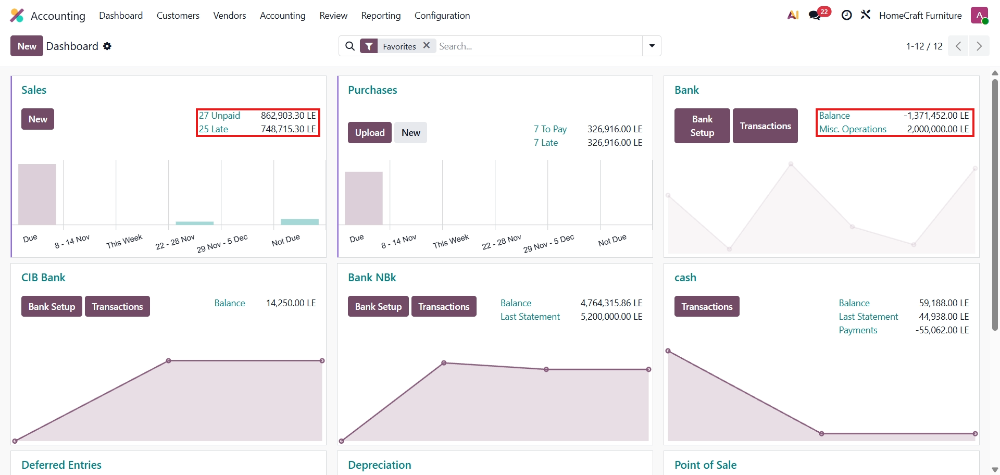

## Configuration

### Chart of Accounts
The chart of accounts lists the account code, name, type, and whether reconciliation is allowed.
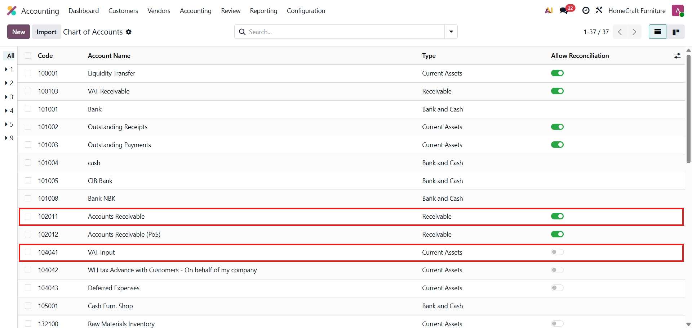

### Taxes
Sales and purchase taxes include 14% VAT, zero-rated and exempt taxes, stamp tax, schedule taxes, and withholding taxes.
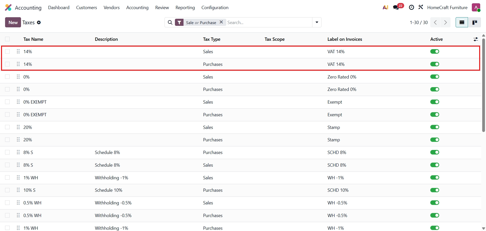

### Journals
Journals include Sales (INV), Purchases (BILL), bank and cash journals, and miscellaneous journals.
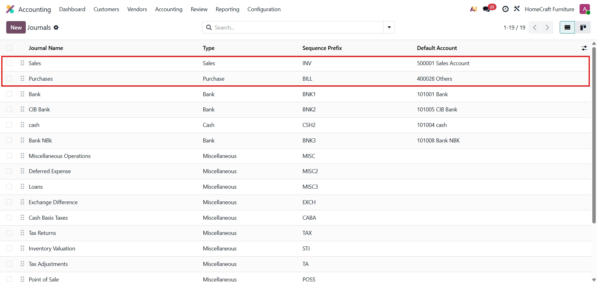

### Payment Terms
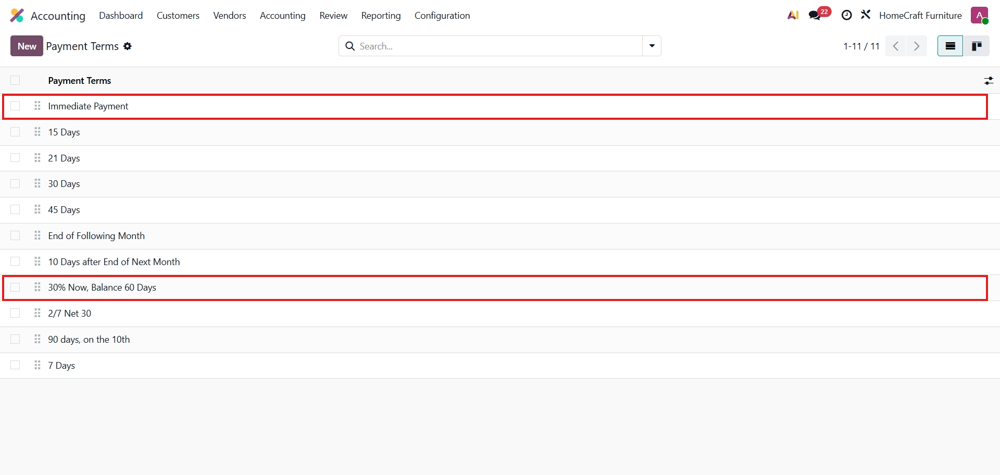

## Opening Balance

The opening balance is recorded in a miscellaneous journal entry dated October 1: 2,000,000 LE debited to 101001 Bank and credited to 301001 Opening Balance Equity.

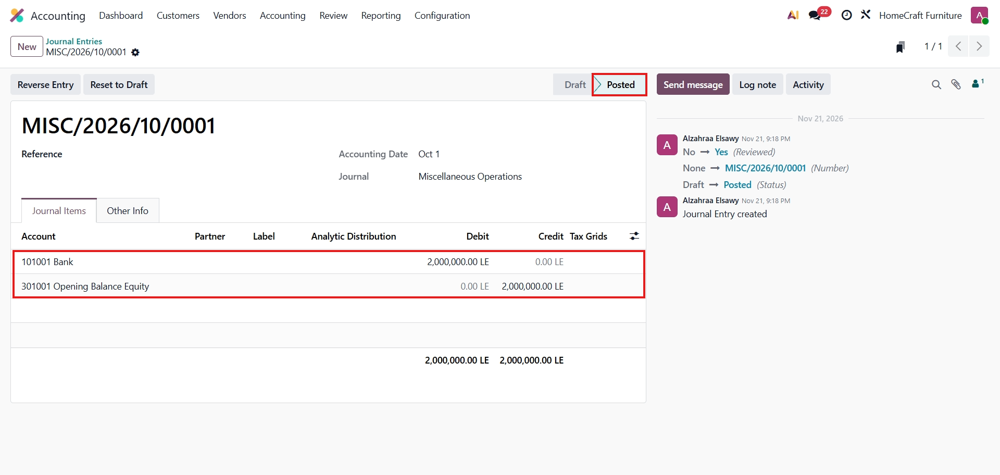

## Trial Balance

The Trial Balance for November 2026 shows the initial balance, debit, credit, and end balance of each account. The report is set to posted entries; the banner notes that unposted journal entries also exist in the period.

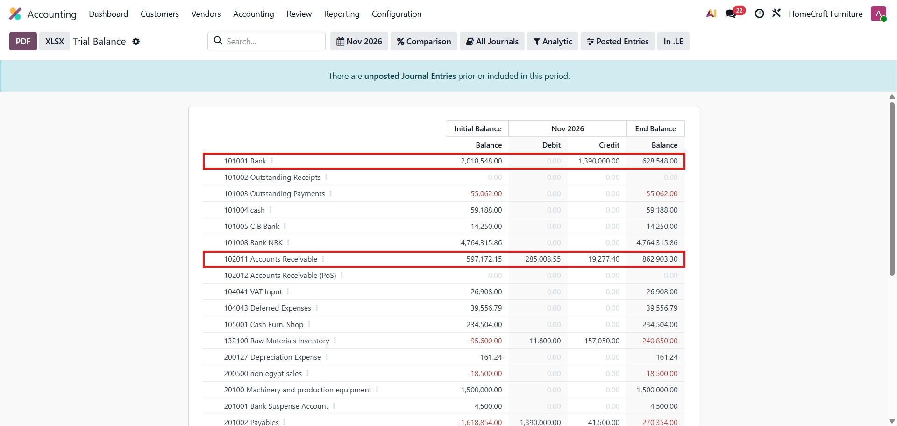

## Customer Invoice and Payment

Invoice INV/2026/00006 for Mariam Mahmoud: one 6-Seater Dining Table (12,500 LE untaxed, 1,750 LE VAT, 14,250 LE total). The invoice line is split by analytic distribution between the Cairo and Alex branches, and the invoice is fully paid.

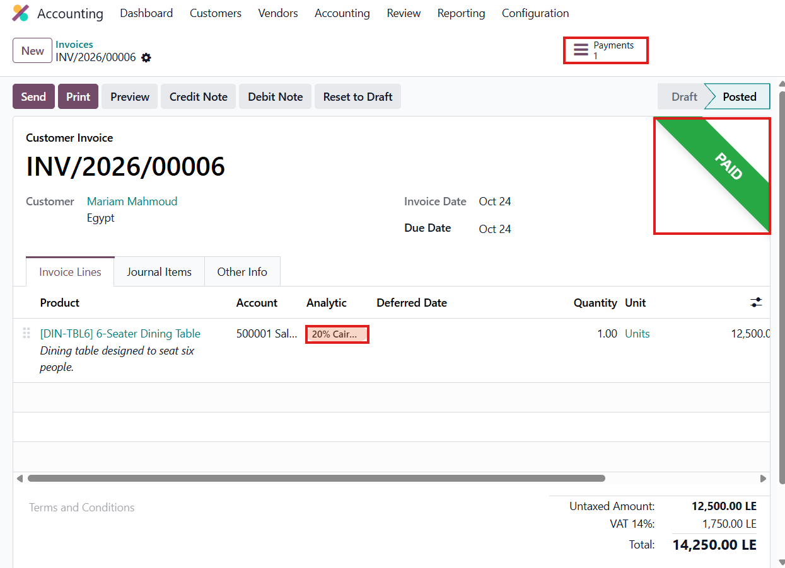
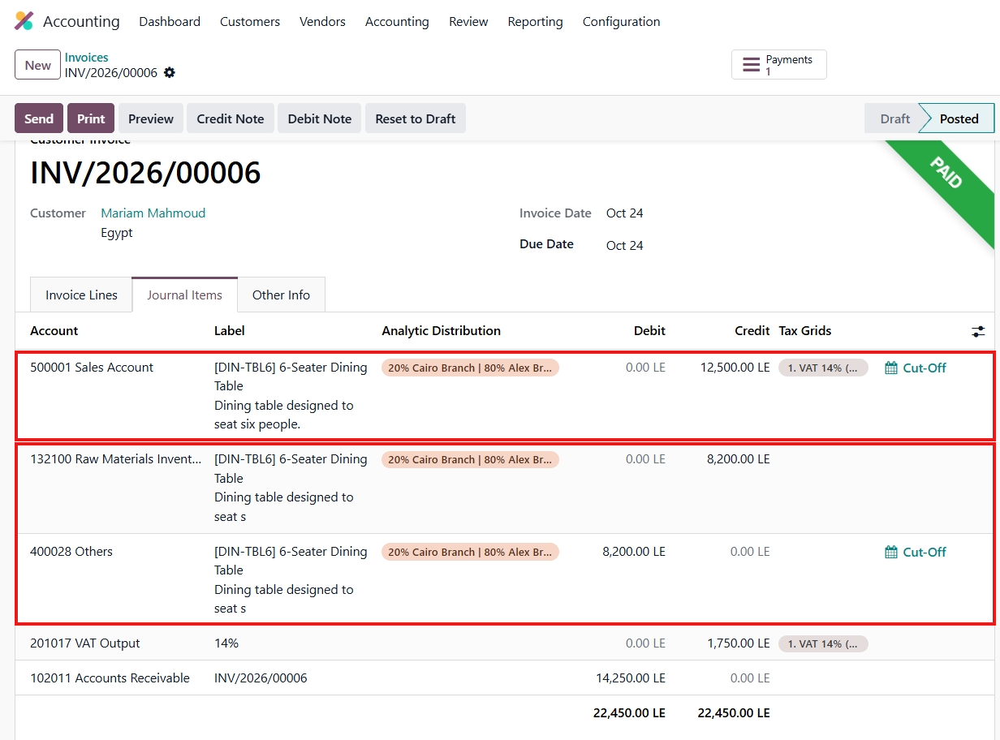

## Deferred Revenue

Invoice INV/2026/00027 bills the Furniture Installation Package (5,000 LE) with a deferral period from October 27, 2026 to October 27, 2027. Odoo moves the amount from Sales Account to Deferred Revenue and creates monthly deferral entries.

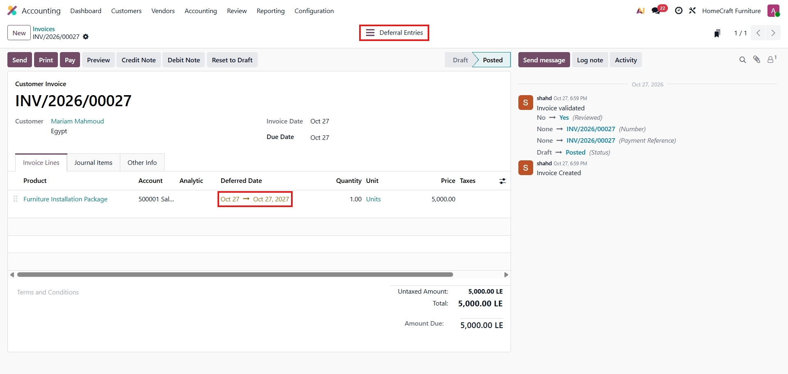
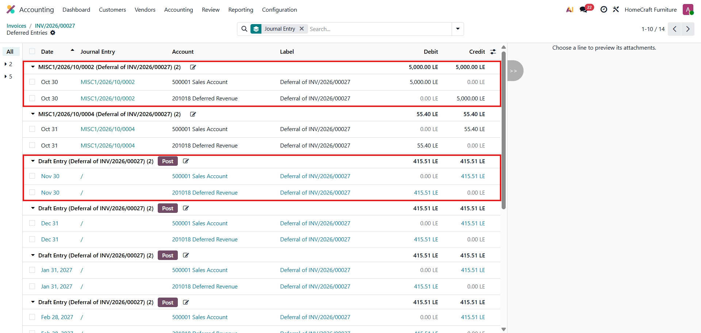

## Vendor Bills

The Bills list shows vendor bills and their payment status.
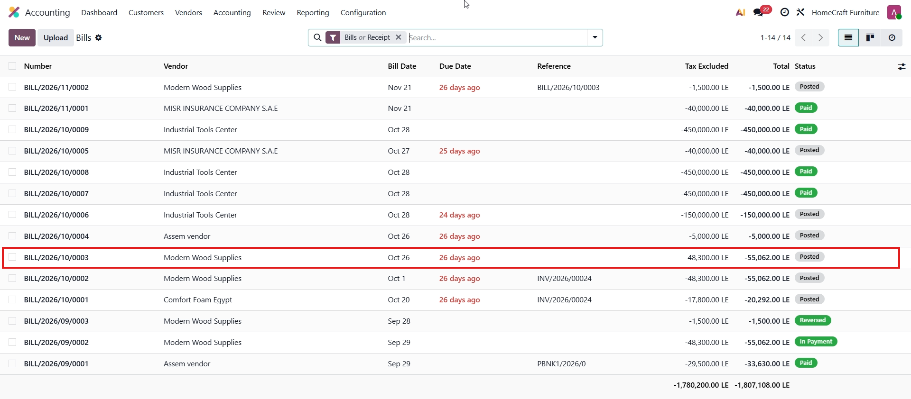

Bill BILL/2026/10/0003 from Modern Wood Supplies was created from purchase order P00009 (Purchases button). Untaxed amount 48,300 LE, VAT 14% 6,762 LE, total 55,062 LE.
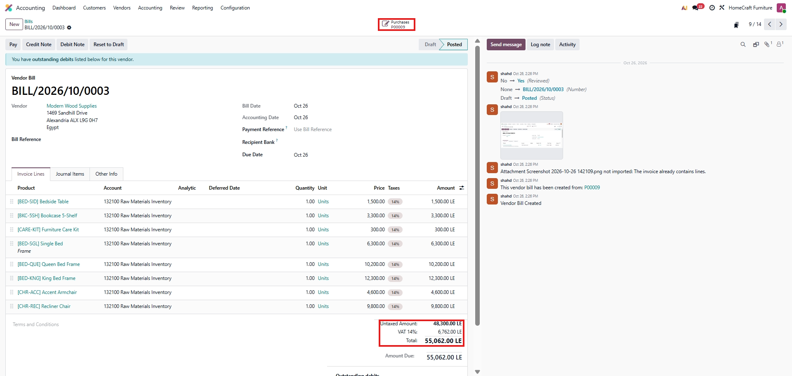

Its journal items debit Raw Materials Inventory per product and VAT Input, and credit Payables.
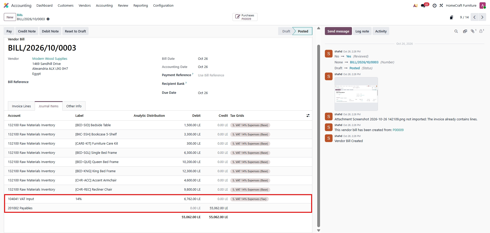

## Budgets

Budgets compare the planned amounts with the actual results by analytic account (branch). The list shows three open budgets: Q3 for 2026, Q4 for 2026 - Alex Revenue, and Q4 for 2026 - Alex Expense.

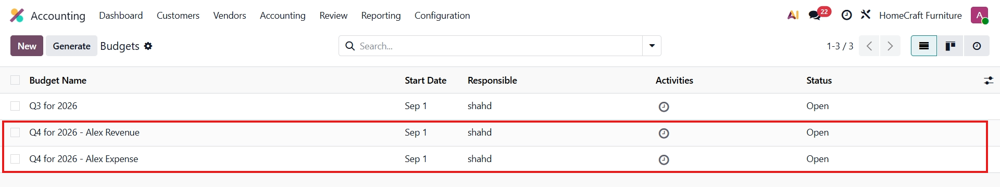

The Q4 for 2026 - Alex Revenue budget is a revenue budget for Alex Branch, with a period from September 1 to December 31. The budget line shows a budgeted amount of 2,500,000 LE and an achieved amount of 64,450 LE. The Budget Report button opens the comparison report.

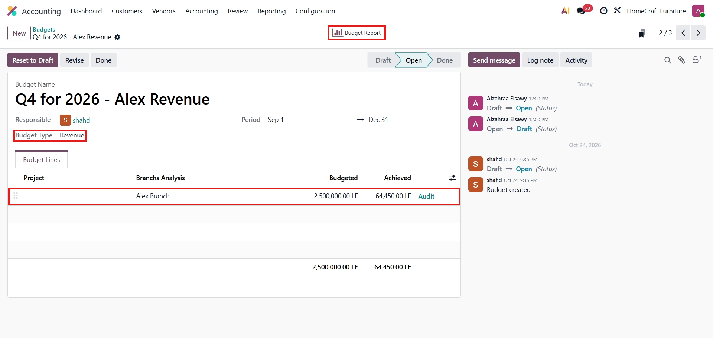

The Budget Report compares the budget, committed, and achieved amounts. For Alex Branch it shows a budget of 2,500,000 LE, with 64,450 LE committed and 64,450 LE achieved.

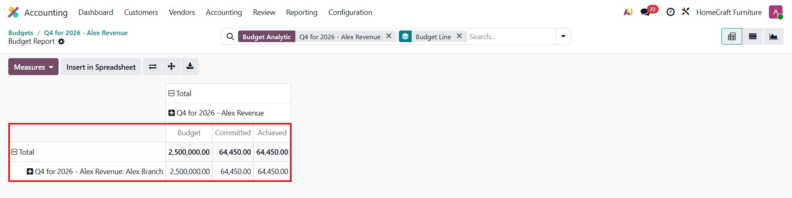
