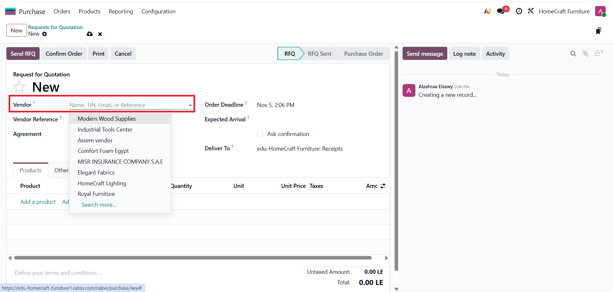
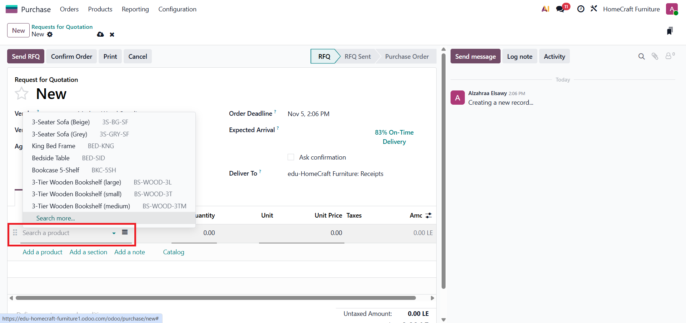
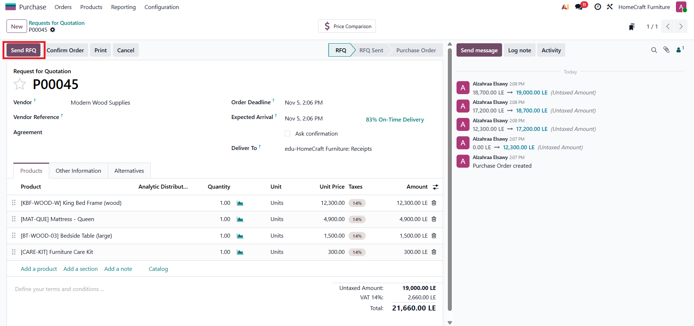
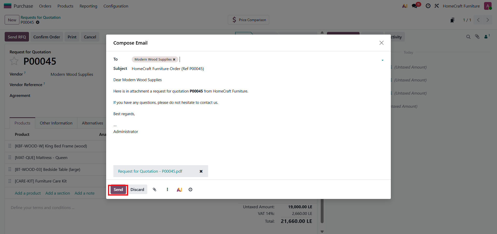
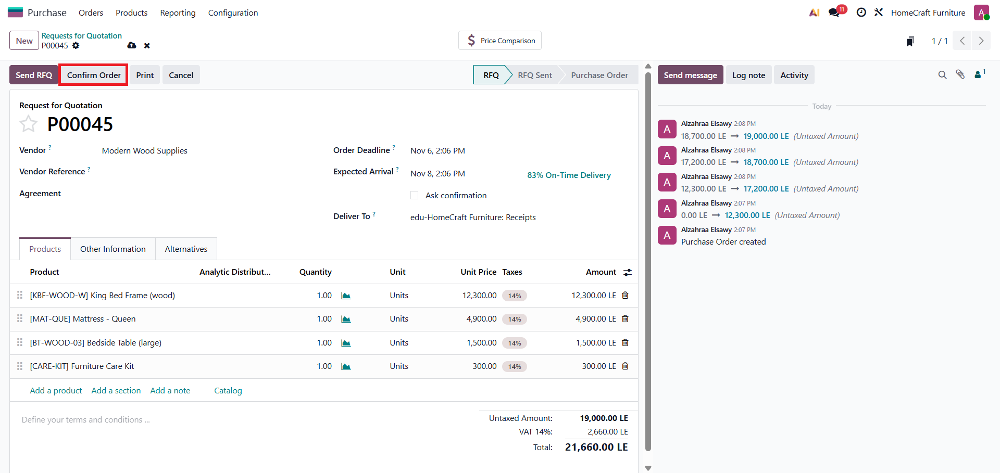
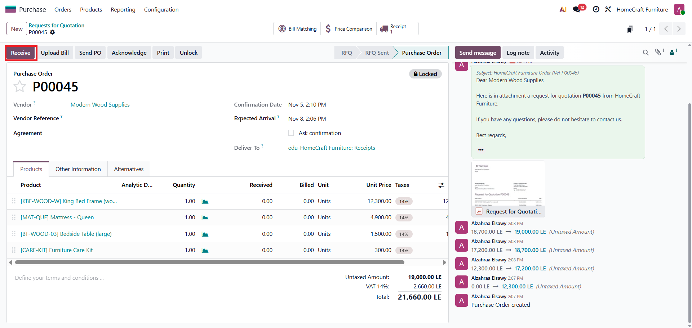
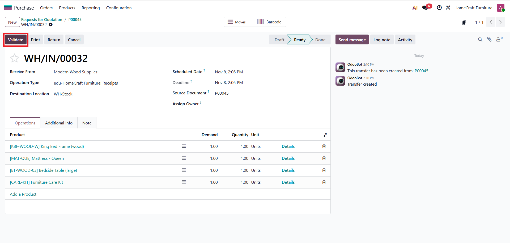
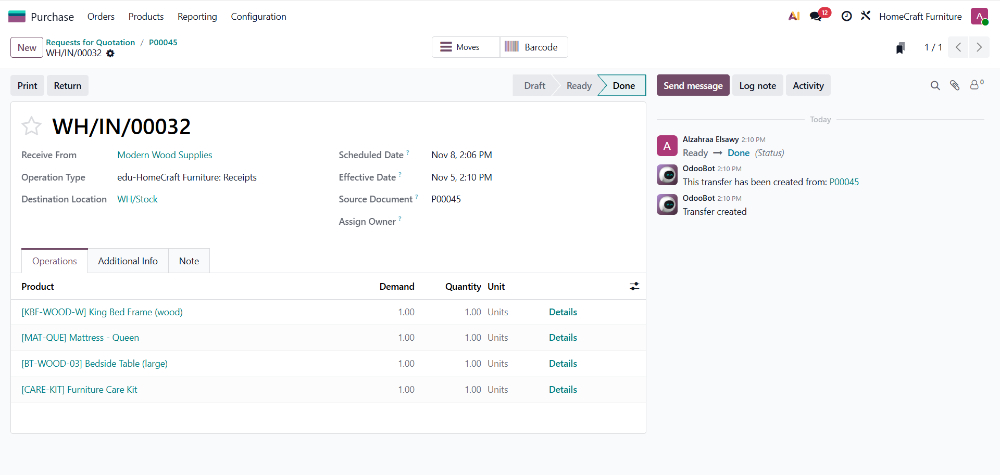
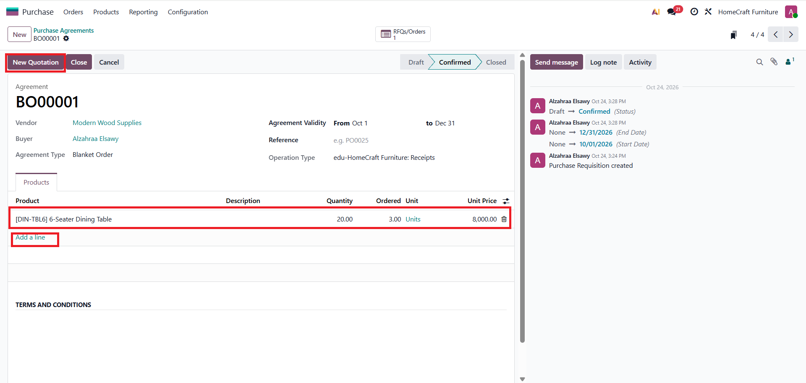
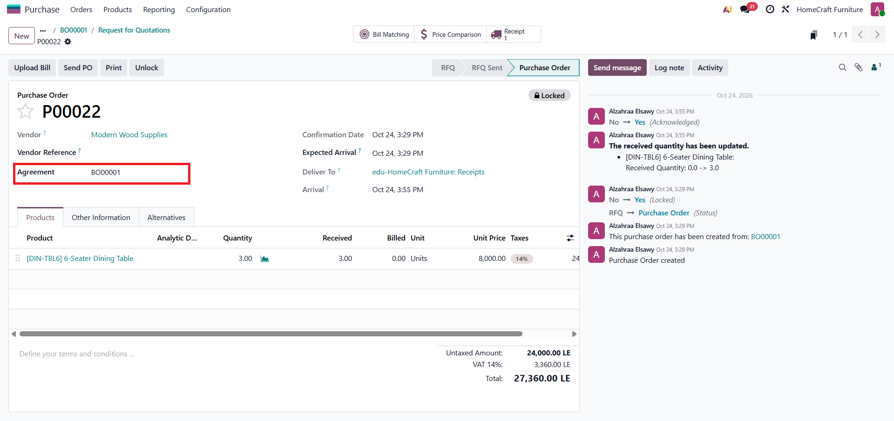

# Purchase Module

This page shows the Purchase module workflow and configuration in Odoo for HomeCraft Furniture.

## Purchase Order Workflow

### 1. Create a Request for Quotation (RFQ)
Create a new RFQ and select the vendor.

### 2. Add products
Add the required products and quantities to the RFQ.

### 3. Send the RFQ to the vendor
Click Send RFQ, then send the email with the RFQ PDF attached.

### 4. Confirm the order
Confirm the RFQ to convert it into a Purchase Order.

### 5. Receive the products
Click Receive to open the receipt created automatically for the order.

### 6. Validate the receipt
Validating the receipt updates the stock and marks the receipt as Done.

> After receiving the products, the vendor bill is created and posted in the Accounting module.

## Purchase Agreement (Blanket Order)

A blanket order is an agreement with a vendor for a defined period. It records the vendor, the validity dates, and the products with the agreed quantity and unit price. Purchase orders can be created from the agreement, and the ordered quantity is tracked against the agreed quantity.

The purchase order created from the agreement shows the agreement reference and uses the agreed unit price.

## Module Screenshots

### Vendors

### Products

### Requests for Quotation

### Purchase Agreements

### Product Categories

### Attributes

### Purchase Analysis

